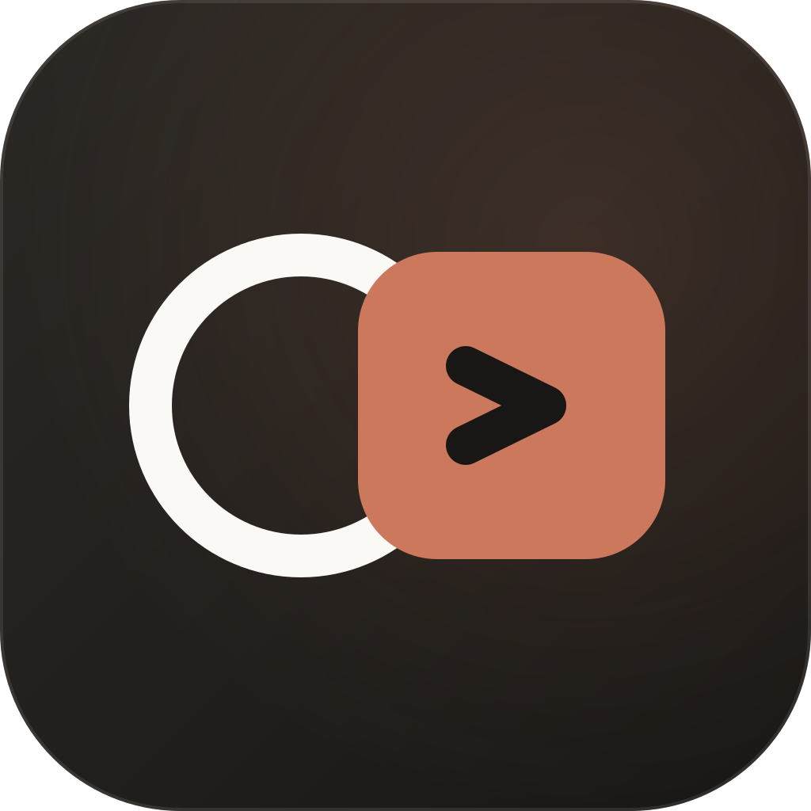
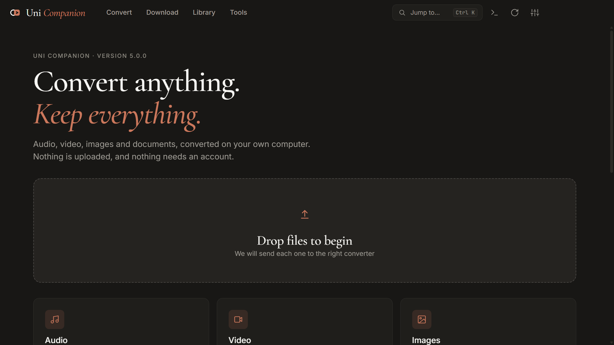
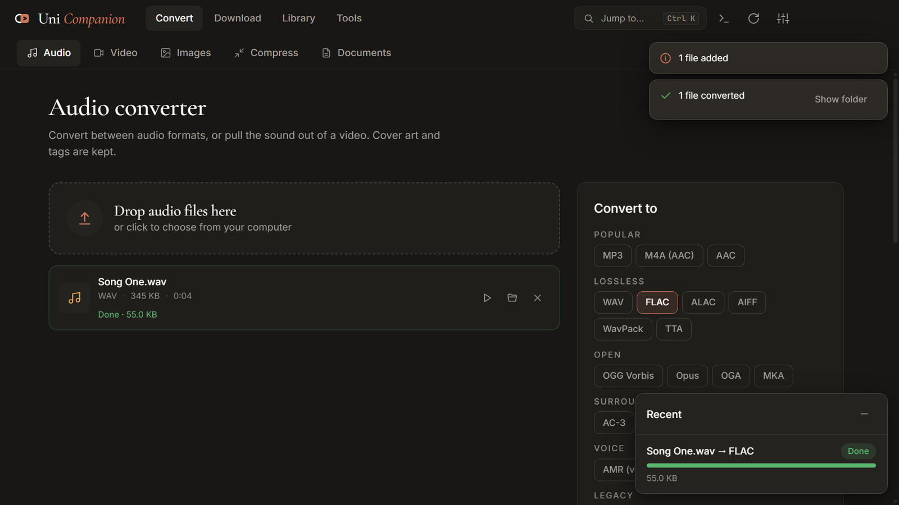
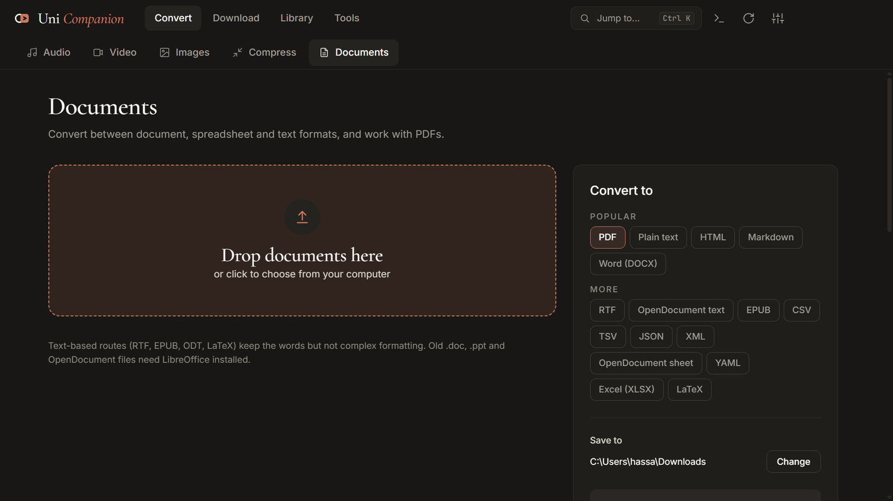
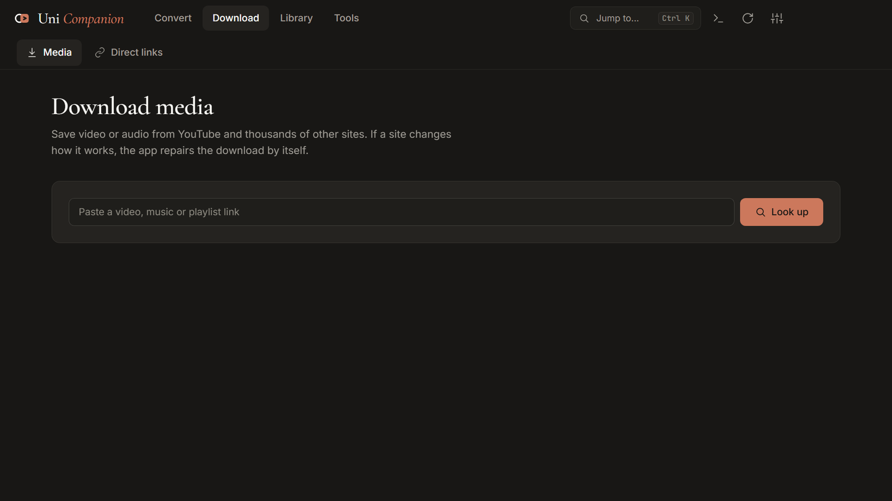
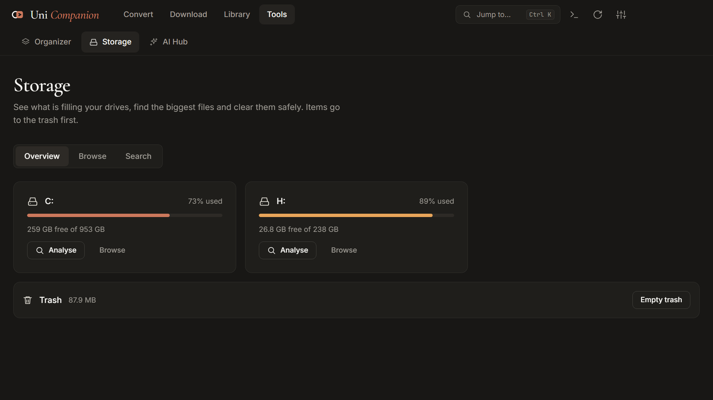

<p align="center">
  
</p>

<h1 align="center">Uni Companion</h1>

<p align="center">
  <b>Convert anything. Keep everything.</b><br>
  A fast, private desktop app to convert audio, video, images and documents,<br>
  download media from thousands of sites, and keep your files tidy.
</p>

<p align="center">
  <a href="https://github.com/Hasan580/universial-file-converter/releases/latest"></a>
  <a href="https://github.com/Hasan580/universial-file-converter/releases"></a>
  <a href="https://github.com/Hasan580/universial-file-converter/stargazers"></a>
  <a href="https://github.com/Hasan580/universial-file-converter/forks"></a>
</p>

<p align="center">
  <a href="LICENSE"></a>
  
  
  <a href="https://github.com/Hasan580/universial-file-converter/actions"></a>
</p>

<p align="center">
  <a href="https://github.com/Hasan580/universial-file-converter/releases/latest"><b>Download</b></a> &nbsp;·&nbsp;
  <a href="#what-it-does">Features</a> &nbsp;·&nbsp;
  <a href="https://github.com/Hasan580/universial-file-converter/issues/new/choose">Report a bug</a> &nbsp;·&nbsp;
  <a href="#star-history">Star history</a>
</p>

<p align="center">
  
</p>

Everything happens on your own computer. Nothing is uploaded and nothing needs an account.

> Formerly *Universal File Converter*. The name changed in version 5.0; your settings, history and update path carry over.

<p align="center">
  
  
  
  
</p>

## What it does

| | |
|---|---|
| **Audio** | 24 formats including MP3, FLAC, AAC, Opus, ALAC, WAV, OGG, AC-3. Cover art and tags are kept. |
| **Video** | 26 formats including MP4, WebM, MKV, MOV, GIF, ProRes. Aspect ratio is always preserved. |
| **Images** | 18 formats including JPG, PNG, WebP, AVIF, TIFF, BMP, ICO, PSD. Opens HEIC. Transparency is flattened to white, never black. Reads QR codes. |
| **Documents** | 13 input types and 80+ conversions, each checked by the test suite: PDF, Word, Excel, PowerPoint, Markdown, HTML, RTF, EPUB, CSV, JSON, YAML, XML. Plus PDF lock, merge and text editing. |
| **Media downloader** | Video or audio from YouTube and thousands of other sites with [yt-dlp](https://github.com/yt-dlp/yt-dlp). **It repairs itself:** when a site changes or asks for a sign-in, the app switches client, installs the helper it needs, updates yt-dlp, uses your browser sign-in, or relaxes the format, and tells you what it is doing. |
| **Direct links** | A download manager with pause, resume and queue, and a bridge for a browser extension. |
| **Library and tools** | Music player for YouTube and SoundCloud links and your own files, with lyrics. File organiser (once or automatically). Storage analyser. AI hub (Google Gemini, your own key). |

Every conversion writes to a new file. An existing file, including the one you started from, is never overwritten.

## Download

Get the latest build from the **[Releases page](https://github.com/Hasan580/universial-file-converter/releases/latest)**.

| System | File | Updates |
|---|---|---|
| Windows 10 / 11 (64-bit) | `Uni-Companion-Setup-<version>.exe` (installer) or `Uni-Companion-Portable-<version>.exe` | Installer updates itself |
| macOS (Apple Silicon and Intel) | `Uni-Companion-mac-<version>-arm64.dmg` / `-x64.dmg` | The app tells you and opens the download page |
| Linux (64-bit) | `Uni-Companion-linux-<version>-x86_64.AppImage` or `-amd64.deb` | AppImage updates itself; `.deb` opens the download page |

### First launch

- **Windows** shows a SmartScreen notice because the app is not code-signed yet. Choose **More info**, then **Run anyway**.
- **macOS** may say the app cannot be checked. Right-click it, choose **Open**, then **Open**. If macOS still refuses: `xattr -dr com.apple.quarantine "/Applications/Uni Companion.app"`
- **Linux AppImage**: make it executable (`chmod +x Uni-Companion-*.AppImage`), then run it. The `.deb` installs with `sudo apt install ./Uni-Companion-*.deb`.

## Light on your computer

Uni Companion is built to stay small and quiet. Measured on Windows with the packaged app:

| | |
|---|---|
| Installer | **138 MB** (4.1.0 was 152 MB, with a much older Electron and ffmpeg) |
| Installed size | 422 MB, most of it the Chromium runtime and ffmpeg |
| Memory, idle on the home screen | about **130 MB** (about 210 MB with graphics acceleration on) |
| Memory, parked in the tray | about **85 MB**: the window closes itself when idle and reopens instantly |
| Time to first window | under 0.4 s |

It gets there by rendering in software by default (still smooth: the frame time is a steady 16.7 ms, with about 1% of frames late), loading each feature only when you open it, keeping decoded images out of memory, reading file details with ffmpeg instead of shipping a second 77 MB tool, and leaving out libraries and builds the app never loads. Turn graphics acceleration on under **Settings > Performance** if you prefer.

## If something goes wrong

- **A download says YouTube wants you to sign in.** Open **Settings > Downloads > Signing in to sites** and pick a browser you are signed in with (Firefox works best). Everything is read locally.
- **A download engine problem.** **Settings > Downloads > Repair download engine** reinstalls yt-dlp and its helper.
- **Something else.** **Activity** (the terminal icon) is a plain log of what the app did. Export it and attach it to an [issue](https://github.com/Hasan580/universial-file-converter/issues).

## Build from source

```bash
git clone https://github.com/Hasan580/universial-file-converter.git
cd universial-file-converter
npm install
npm start            # run the app
npm run lint         # static checks
npm test             # conversion and document test suites (real ffmpeg, sharp, converters)
npm run dist:win     # or dist:mac / dist:linux: build an installer into dist/
```

Node 22 or newer. The test suites run inside Electron because the engines use it.

### How it is organised

```
src/main/        the application: window, tray, updater, settings, jobs
  engines/       ffmpeg, images, documents, yt-dlp (with recovery), downloads, storage
  features/      music streaming, download manager, auto organiser
  ipc/           the only way the interface talks to the engines
src/preload/     a small allow-listed bridge (generated: node scripts/gen-preload.js)
src/renderer/    the interface: plain JavaScript modules and CSS, no build step
test/            engine suites and an end-to-end UI harness
```

### Releasing

Pushing a tag such as `v5.0.0` builds Windows, macOS and Linux, runs the tests on all three first, and creates a **draft** GitHub release. Nothing reaches the auto-updater until the draft is published.

## Privacy

No telemetry, no accounts, no cloud processing. The app contacts the network only when you ask it to (downloads, music streaming, the AI hub with your key) and for a few small housekeeping checks: new releases of this app, new releases of yt-dlp, and the notice board in [`alerts.json`](alerts.json).

## Contributing

Issues and pull requests are welcome. See [CONTRIBUTING](.github/CONTRIBUTING.md).

## Star history

<a href="https://star-history.com/#Hasan580/universial-file-converter&Date">
  <picture>
    <source media="(prefers-color-scheme: dark)" srcset="https://api.star-history.com/svg?repos=Hasan580/universial-file-converter&type=Date&theme=dark">
    <source media="(prefers-color-scheme: light)" srcset="https://api.star-history.com/svg?repos=Hasan580/universial-file-converter&type=Date">
    
  </picture>
</a>

If Uni Companion saves you time, a star on the repository helps others find it.

## Licence and credits

Uni Companion is open source under the **[Apache License 2.0](LICENSE)**. You may use, change and share it, including commercially, as long as you **credit the original**: keep the [NOTICE](NOTICE) file and the copyright notice with the code, and say where it came from. In a fork or a derived app, a line like this in your README or About screen is enough:

> Based on [Uni Companion](https://github.com/Hasan580/universial-file-converter) by Hassan F.

Versions up to 4.1.0 were published under MIT with an attribution clause and stay available under that licence.

Built on [Electron](https://www.electronjs.org), [FFmpeg](https://ffmpeg.org), [sharp](https://sharp.pixelplumbing.com), [yt-dlp](https://github.com/yt-dlp/yt-dlp), [pdf-lib](https://pdf-lib.js.org), [pdf.js](https://mozilla.github.io/pdf.js/) and others. Interface type is Cormorant Garamond, Inter and JetBrains Mono, used under the SIL Open Font License.

<p align="center"><b>Made with love by Hassan F.</b></p>
